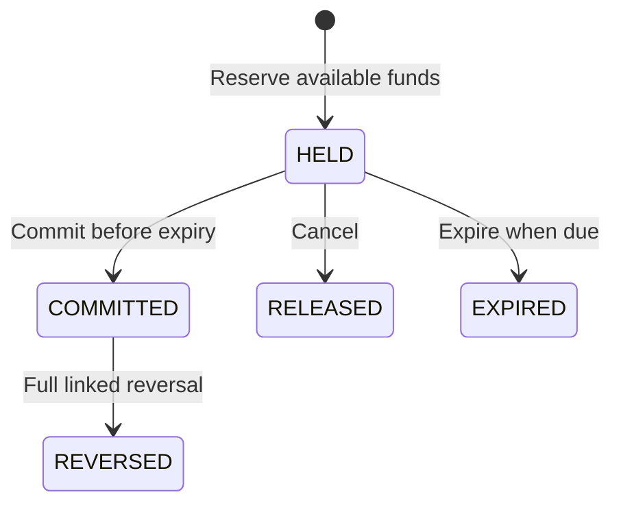

# Managed funds and durable reservations

Managed funds provide an explicit money authority for an enrolled account. The ledger owns booked funds, held funds, available funds, the corresponding balanced postings, and reservation transitions in one local PostgreSQL transaction. Accounts owns the canonical account identity, contract, currency, and lifecycle. A payment coordinator must use the generated SDK and retain its own durable operation state; this API does not complete a payment experience or prove external settlement.

The initial contract supports full-amount, same-currency internal transfers between explicitly enrolled customer accounts in one tenant. It does not support overdrafts, foreign exchange, fees, partial capture, space transfers, external rail settlement, or importing an arbitrary legacy balance. Existing balance CRUD is not a source of opening funds for this authority.

## Money ownership

For a customer account:

```text
available = booked - held
booked >= held >= 0
```

A reservation increases held funds without moving booked money. Commit consumes that hold and moves the exact amount from source booked funds to destination booked funds. Release or expiry removes the hold without moving booked money. A full reversal creates a linked opposite posting and requires sufficient available funds at the original recipient. The original committed posting remains part of the audit trail.

A bank-control account is a separate, explicitly privileged account kind. The sandbox funding command creates a balanced posting between that account and a customer account. Its bank-control booked amount may be negative. This is an explicit synthetic funding facility, not a customer credit endpoint, an arbitrary opening-balance import, or proof of money received from an external bank.

Amounts must be positive, fit `NUMERIC(38,18)` exactly, and respect each account's stored ISO currency precision. Resulting balances and held totals are checked before effects. Enrollment stores the currency scale and a deployment-supplied currency policy version. Pin the deployment's JDK/currency data and policy label; changing a label does not rewrite existing account precision or authorize a cutover.

## Safe enrollment

Enrollment is privileged and opt-in. A global account UUID or a contract UUID alone does not establish tenant or customer ownership.

The issuer must approve the exact tuple in a signed `funds_enrollments` claim:

```json
{
  "tenant_id": "sandbox-bank",
  "funds_accounts": ["11111111-1111-4111-8111-111111111111"],
  "funds_enrollments": [{
    "tenantId": "sandbox-bank",
    "accountId": "11111111-1111-4111-8111-111111111111",
    "contractId": "22222222-2222-4222-8222-222222222222",
    "currency": "USD",
    "kind": "CUSTOMER"
  }]
}
```

This is a claim example, not an unsigned token accepted by the service. The actual access token must have a finite expiration, trusted issuer, configured audience, subject, required scopes, exact tenant, and exact resource grants. The institution's issuer/enrollment policy is responsible for establishing the underlying business association. The platform does not infer that association from the existing opaque party/customer-position records.

Use the same immutable enrollment identifier throughout:

1. Create a canonical account through accounts, with its real contract/currency and no money history. Begin accounts enrollment. Accounts checks the signed tuple against the actual locked account and freezes alternate managed-account writes.
2. Enroll the same account and tuple in ledger. Ledger checks its own zero-history gate and creates only `BLOCKED`, zero-booked, zero-held authority.
3. Link the enrollment in accounts, committing `MANAGED` and the active lifecycle linkage.
4. Request ledger `ACTIVE`. Ledger uses the generated accounts SDK with its own client-credentials identity. It verifies the committed mode/control and exact account, enrollment, contract, currency, and kind before activating funds.

A crash between these steps leaves an unusable or conservatively blocked enrollment. Retry the same immutable intent. A conflicting tuple is an explicit conflict; do not overwrite identities, seed customer money, or bypass the migration/enrollment gates.

Accounts accepts only a fresh open account without an overdraft or incompatible history, balances, restrictions, interest, term-deposit, statement, limit, or sweep records. One empty, unfrozen default `MAIN` space is allowed. Its legacy money operations remain fenced after enrollment. Existing financial history requires a separately designed and reconciled migration, not this zero-history enrollment path.

## Reservation lifecycle



Every create uses a stable `operationId`; every transition uses a stable `actionId`. Reuse the original intent on recovery. Reusing an identifier with different accounts, amount, currency, action, relative TTL, or absolute deadline conflicts. Current permissions are rechecked on replay.

The ledger serializes the tenant/operation identity before locking the complete account set in a stable order. Reservation, account balances, balanced posting, status history, immutable audit, and outbox records commit or roll back together. Generic aggregate/header/leg/history and terminal replay routes cannot bypass enrolled-account authority. The existing generic posting service also prelocks its complete account set so opposite unmanaged postings retain a consistent lock order.

### Pin an absolute deadline

`ttlSeconds` is required and bounded from 1 through 900. The optional `notAfterEpochMillis` is an exact positive integer no later than the last millisecond of year 9999. Strings, fractions, and integer overflow are rejected. For a new reservation:

```text
effective expiry = min(core time + ttlSeconds, notAfterEpochMillis)
```

An absent absolute deadline preserves relative-TTL compatibility. A durable payment coordinator should always pin an absolute deadline and preserve it across retries. At or after that deadline, a new hold is rejected before effects. An identical existing operation still replays after expiry; replay does not create a fresh reservation or extend its expiry.

### Recover a lost create response

`GET /api/v1/tenants/{tenant}/funds/reservations/by-operation/{operationId}` returns the actual reservation under current tenant/pair read permission. It takes the same operation gate as create, so an admitted in-flight transaction must finish before lookup can report absence. A missing or invisible resource is an explicit 404.

A normal 404 is not a terminal no-effect receipt. It deliberately does not disclose resources outside the caller's current grants.

### Close an absent operation authoritatively

`POST /api/v1/tenants/{tenant}/funds/reservations/reconciliation` takes the exact original reserve intent with a nonnull pinned deadline and requires `funds:reconcile` plus both current account grants.

- `FOUND` contains the actual current reservation and no invented receipt identifier.
- Before the ledger's clock reaches the deadline, an absent operation returns `RECONCILIATION_DEADLINE_NOT_DUE`.
- At or after that deadline, an absent operation atomically commits `ABSENT_CLOSED`: a stable receipt identifier, ledger-observed time, pinned deadline, full canonical intent, immutable operation fence, audit event, and outbox record. It contains no fabricated reservation or posting.

The receipt occupies the same tenant/operation namespace as reserve/funding. A later reserve cannot create a hold for that closed operation, including after restart or clock rollback. Changing the original intent conflicts. A hidden global identifier collision is an explicit conflict rather than an empty success. Database constraints and a private posting-key fence reject incomplete closure records and later matching reservation/posting writes.

The `RECONCILE` database context can insert only the dedicated receipt/audit/outbox metadata. It does not grant booked-funds, reservation, or managed-posting write authority. Only a successfully returned committed receipt establishes this exact no-effect outcome. A timeout or failed audit/outbox write requires recovery; it is not evidence of closure.

### Expire durable holds

`POST /api/v1/tenants/{tenant}/funds/reservations/expiry` accepts `{"limit": 10}`, with a limit from 1 through 100. An authenticated worker with `funds:expire` and bounded account grants discovers due persisted holds and invokes the normal idempotent expiry transition. Each transition has its own local transaction and deterministic action identifier. Multiple workers serialize through the same operation/account gates. The API does not install a deployment scheduler or depend on an in-memory timer; configure the institution's scheduler and workload/resource partitioning explicitly.

## API and permissions

All paths below are relative to `/api/v1/tenants/{tenant}/funds`.

| Method and path | Required scope | Additional rule |
| --- | --- | --- |
| `POST /accounts/{id}/enrollment` | `funds:enroll`, `funds:tenant-bind` | Exact signed enrollment tuple; bank-control also requires `funds:bank-enroll` |
| `GET /accounts/{id}` | `funds:read` | Current account grant |
| `POST /accounts/{id}/controls` | `funds:control` | Current account grant; activation verifies accounts |
| `POST /funding` | `funds:fund` | Exact bank-control/customer pair; explicit privileged balanced funding |
| `POST /reservations` | `funds:reserve` | Exact customer pair and immutable intent |
| `GET /reservations/{id}` | `funds:read` | Both stored accounts must be granted |
| `GET /reservations/by-operation/{operationId}` | `funds:read` | Same operation gate; both stored accounts must be granted |
| `POST /reservations/{id}/actions` | Action-specific scope | `funds:commit`, `funds:release`, `funds:expire`, or `funds:reverse` |
| `POST /reservations/reconciliation` | `funds:reconcile` | Exact original intent and pinned deadline |
| `POST /reservations/expiry` | `funds:expire` | Bounded batch and bounded current account grants |

Use the generated `LedgerFundsApi`; do not write a parallel handwritten client contract. The authenticated principal is injected by the runtime and is not a query parameter supplied by SDK callers. The core's durable identifiers are independent of optional HTTP-cache idempotency headers.

## Retained monetary receipts

`GET /api/v1/tenants/{tenant}/funds/reservations/{id}/monetary-receipts` returns typed retained monetary evidence through the generated `LedgerFundsApi.getFundsMonetaryReceipts` operation. Reading a reservation requires both stored account grants. The response separates the immutable accepted reserve, original COMMIT, linked REVERSE when present, and the current reservation. `HISTORICAL_UNAVAILABLE` does not supply replacement monetary evidence.

The interfaces module exposes `io.fireflysoftware.core.banking.ledger.interfaces.protocol.receipt.FundsReceiptCodec` for canonical envelope verification and decoding. It validates exact original intent, enrollment representation, monetary amounts, balance transitions, receipt identities, and reversal links. Preserve the complete envelope and explicit null original links on COMMIT. A reversal retains the original accepted intent and identifies its original receipt and posting; it is a separate effect.

Canonical bytes and their digest establish protocol integrity, not authenticated ledger ownership or current permission. Consumers must fetch from the actual authenticated owner, bind the exact selected tenant/reservation/receipt/action/posting, and independently authorize their own operation. Historical actor fields do not identify the consumer's current executor. An unavailable owner or missing historical evidence remains unavailable; a balance, status, or matching digest is not a substitute.

These are source contracts. Building this source does not change previously published artifacts with the same version. Select the matching interfaces and generated SDK from one coherent source build or a separately coordinated release. The original producer writes the canonical SDK input at `core-banking-ledger-sdk/src/main/resources/openapi.yml`; Maven derives the packaged `/api-spec/openapi.yml` compatibility alias from that file. Do not maintain an independent alias or edit generated SDK classes.

## Configuration

| Property | Purpose |
| --- | --- |
| `funds.security.issuer` | Trusted token issuer |
| `funds.security.audience` | Ledger funds API audience |
| `funds.security.jwk-set-uri` | Issuer key endpoint used by resource-server verification |
| `funds.currency-policy.version` | Required bounded label for the enrolled precision policy |
| `funds.accounts.base-url` | Actual accounts service base URL |
| `funds.accounts.token-uri` | Client-credentials token endpoint for the accounts peer |
| `funds.accounts.client-id` | Ledger's separate accounts-verification client identity |
| `funds.accounts.client-secret` | Secret supplied by the deployment secret store |
| `funds.accounts.scopes` | Issuer-approved peer scopes, including `funds:verify` |
| `funds.accounts.allow-loopback-http` | Explicit local qualification option; false by default |

Peer URLs require HTTPS unless explicit loopback HTTP is enabled. Verification uses bounded token/observation timeouts and response size, and never relays the caller's bearer token. Missing or invalid peer configuration fails closed. Deployment must also configure the normal database/R2DBC settings and separate Flyway/bootstrap credentials.

## Database roles and visibility

Provision helper roles before applying the migrations:

```sql
CREATE ROLE firefly_funds_policy_reader NOLOGIN NOSUPERUSER NOBYPASSRLS;
CREATE ROLE firefly_funds_policy_writer NOLOGIN NOSUPERUSER NOBYPASSRLS;
CREATE ROLE funds_runtime LOGIN NOSUPERUSER NOBYPASSRLS;
```

Manage authentication through the institution's secret mechanism. Use a separate migration/bootstrap owner for schemas, migrations, and ownership changes. Grant runtime only the required public table DML and sequence privileges; revoke public-schema creation. Runtime must not own protected relations or inherit migration, policy-owner, superuser, or RLS-bypass authority. The private visibility and closed-posting schemas are not exposed to runtime.

The migrations assign fixed-path, qualified security-definer metadata predicates/triggers to the nonlogin helper roles with narrow SELECT/INSERT privileges. Runtime managed-funds operations reject privileged or protected-table-owner connections and invalid policy-owner setup. All linked ledger header, leg, history, posting claim, funds, operation, action, control, audit, and outbox relations use forced RLS for enrolled resources. Legacy unmanaged rows retain their established visibility.

Only the validated native service transaction establishes its narrow tenant/account/purpose context on the same connection with transaction-local settings. This is not a request-header or global Boolean bypass. Commit, rollback, cancellation, and pool reuse must clear the context. RLS is an application integrity/privacy backstop; it is not a claim to constrain database administrators or arbitrary stolen SQL credentials.

## Operations and recovery

| Situation | Required response |
| --- | --- |
| Enrollment stopped halfway | Retry the original identities; observe both owners; keep ledger blocked until committed linkage verifies |
| Reserve response lost | Read by operation; use exact intent reconciliation if a terminal no-effect decision is required |
| Commit/release race | Read the authoritative reservation; exactly one terminal transition wins |
| Commit attempted after expiry | Do not move money; run expiry/recovery through the owning command |
| Account freeze response lost | Accounts retains a pending control; retry the same durable action through accounts |
| Closure rejected with booked or held funds | Keep ledger blocked; accounts records a definitive rejected close; resolve funds before a new control |
| Audit/outbox failure | Local transaction rolls back; recover by the same durable identity |
| RLS hides a conflicting operation receipt | Return an explicit conflict; never reinterpret an empty result as success |
| Legacy history found at enrollment | Stop zero-history enrollment and design a reconciled migration |

Monitor database transaction failures, pending lifecycle controls, due holds, outbox backlog, unavailable peer verification, policy-role misconfiguration, and recovery age. Do not restore availability by writing legacy balance tables, changing resource identities, or disabling the managed-account fences.

For accounts lifecycle configuration and the reusable actual-executable qualifier, see the [accounts managed-funds guide](https://github.com/fireflysoftwaresolutions/core-banking-accounts/blob/main/docs/managed-funds.md).

## Optional FIRST reserve ingress

`firefly.ledger.first-reserve-capture.enabled` is false by default. Enabling it selects the existing owning FIRST reserve entrypoint only for `POST /reservations`. The owning-mutations, audit-capture, and reserve-completed-witness switches must also be enabled. Startup requires one explicit `LedgerMutationTime`, the real FIRST capture provider, trusted principal port, call-local audit appender, audit-record service, and completed-command witness service. No time source, issuer, provider, native anchor, or permission is synthesized when a dependency is missing.

The highest-precedence reserve filter creates one original five-second budget before authentication or body reads. Every subscription and the response commit check retain that exact budget and the same clock and monotonic supplier used by the owning service. Expired queued success bodies are cancelled and replaced with a code-only unavailable response where the response is still uncommitted. This cooperative boundary does not guarantee a physical network delivery time or PostgreSQL physical-commit deadline.

The existing funds security chain keeps its decoder, issuer/audience validators, order, and route matcher. When FIRST capture is enabled, its genuine framework converter requires a signed `tenant_id` string with no header or default-tenant fallback and preserves the complete issuer, expiration, resource claims, and legacy space-delimited scope semantics. Existing funds and monetary-receipt controllers accept the resulting genuine principal unchanged; disabled deployments retain their original JWT projection.

FIRST reserve requests reject the configured HTTP response-cache key header with a code-only `400` and `Cache-Control: no-store`, before any cache or reserve handler effect. The key name comes from the same framework `IdempotencyProperties` used by its response cache, including a custom name and case-insensitive header lookup. This fence is limited to the enabled reserve route; it does not disable other idempotency filters or alter default deployments. Retry the immutable durable `operationId` through the owner so each request, including a durable replay, obtains fresh FIRST permission. Do not use an HTTP response-cache replay as admission evidence.

This wiring does not supply the qualified production FIRST capture provider or audit-anchor ABI. Those capabilities, original Main/SDK generation, actual owner HTTP, native production composition, physical finality, and Experience-to-Domain-to-Core acceptance require separate qualification. Controlled source tests and a native reader component are not financial or release acceptance.
